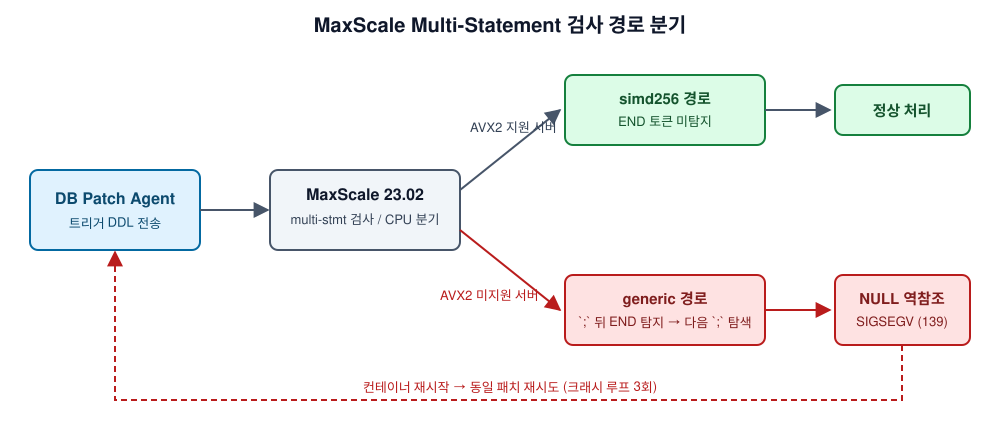

# MaxScale SIGSEGV 크래시 루프 RCA — AVX2 미지원 CPU와 Multi-Statement 검사 경로 차이

## 1. 배경

### 가. 증상
1) 커스텀 개발 버전 설치 중 DB 패치 앱이 트리거 생성 DDL을 실행하는 순간 MaxScale이 `signal 11`(exit 139)로 종료
2) 재시작마다 같은 패치를 재시도해 크래시 루프가 반복되고, MaxScale 경유 DB 서비스 3개가 모두 중단

### 나. 원인
1) MaxScale의 multi-statement 검사는 CPU의 AVX2 지원 여부에 따라 SIMD 경로와 generic 경로로 나뉘며, 두 경로가 구문 끝 `END` 토큰을 다르게 처리
2) AVX2 미지원 서버(generic 경로)에서 `;` 직후 `END`가 오고 이후 `;`가 없으면 NULL 포인터를 역참조해 SIGSEGV 발생
3) 동일 버전·설정·패치 SQL의 정상 서버와 비교해 AVX2 유무가 유일한 차이임을 확인하고, Loki 로그로 크래시 직전 세션을 추적해 문제 패치를 특정
4) 업스트림 이슈 [MXS-4821](https://jira.mariadb.org/browse/MXS-4821)에 해당하며 23.08.2에서 조치됨

## 2. 조치 및 기대효과

### 가. 우회 (적용)
1) 트리거·프로시저 본문을 `END;`로 종료하도록 패치 작성 가이드를 배포해 동일 패턴의 크래시 경로 차단

### 나. 영구 조치 (예정)
1) MaxScale 23.08.2 이상 업그레이드 — 일정은 업무 우선순위로 추후 진행

### 다. AS-IS / TO-BE 비교

| 항목 | AS-IS | TO-BE |
|---|---|---|
| 패치 SQL 작성 | 트리거 본문 `END` 뒤 `;` 없이 공백·주석 허용 | `END;`로 종료하는 가이드 적용 |
| 비-AVX2 서버 | 해당 패턴 실행 시 크래시 루프 | 우회로 크래시 조건 회피 |
| MaxScale 버전 | 23.02 (결함 포함) | 23.08.2 이상 업그레이드 예정 |

## 3. 구성도 (Topology)



```
DB Patch Agent ── 트리거 DDL ──▶ MaxScale 23.02
                                    │
                    ├── AVX2 지원 ──▶ simd256 경로 ──▶ 정상 처리
                    └── AVX2 미지원 ─▶ generic 경로 ──▶ NULL 역참조 (SIGSEGV)
                                                          │
                              컨테이너 재시작 ◀───────────┘
                              동일 패치 재시도 → 크래시 루프
```

## 4. 회고 및 향후 제언 (중간 회고)

진행 중인 조치가 남아 있으므로 현 시점까지의 회고다.

### 가. 다시 진행한다면
1) 동일 설정인데 한 서버에서만 크래시가 나면 CPU 플래그(`/proc/cpuinfo`의 avx2)부터 대조해 원인 격리 시간을 단축
2) 구축 사전 점검에 AVX2 지원 여부를 추가하고, MaxScale 재시작·exit 139 알람으로 크래시 루프를 조기 인지

## 5. 역할 범위
1) 원인 분석, 우회책 적용(패치 작성 가이드 배포), RCA 문서 작성까지 단독 수행
