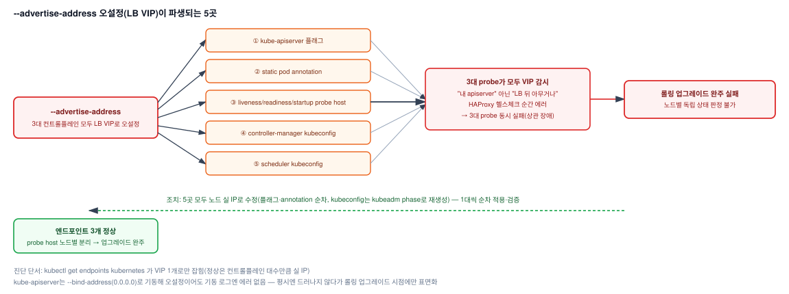

# kube-apiserver HA 오설정으로 인한 kubeadm 업그레이드 실패 대응

> 본 문서가 다루는 3대 컨트롤플레인 HA 클러스터(HAProxy LB) 구조는 선행 프로젝트 [07-saas-k8s-ha-master-worker-separation.md](07-saas-k8s-ha-master-worker-separation.md)에서 설계한 것이다. HA 아키텍처는 동료 엔지니어와 공동 설계했고, 실제 클러스터 설치는 다른 담당자가 설치 자동화 툴로 수행했다. 본 장애의 진단·조치는 단독 수행.

## 1. 배경

### 가. 증상

1) 3대 컨트롤플레인 HA 클러스터에서 kubeadm 패치 버전 업그레이드 도중 업그레이드 실패
2) 업그레이드 동안 ha-proxy에서 apiserver probe 실패 조회 —
   원인 진단부터 조치까지 단독 수행
3) 업그레이드 중 서비스 트래픽이 일시적으로 흔들림

### 나. 원인

1) 3대 컨트롤플레인 모두 kube-apiserver의 `--advertise-address`가 각 노드의 실제 IP가 아니라
   LB VIP로 동일하게 오설정
2) 이 값이 엔드포인트 등록, kubelet probe host, controller-manager/scheduler kubeconfig까지
   총 5곳에 그대로 파생되어, 노드별로 독립이어야 할 상태 판정이 LB라는 단일 지점에 묶임
3) 업그레이드 중 LB의 backend health-check가 일시적으로 에러 발생하여 3대 kubelet의 probe가
   동시에 실패 — 롤링 업그레이드가 "이 노드만의 상태"를 판별하지 못해 완주 실패

## 2. 원인 좁혀가기

| 순서 | 가설 | 검증·조치 | 결과 |
|---|---|---|---|
| 1 | IDC 네트워크 문제 (같은 시간대 IDC 정기점검 작업 진행 중, HAProxy health-check 전체 실패) | 롤링 업그레이드 진행 상황과 실패 패턴 대조 | 한 대씩 내리는 중인데 3대 probe가 동시에 실패 — 노드별 상태가 아니라 공통 지점에 묶인 구조를 의심 |
| 2 | 노드별 상태 판정이 공통 지점(LB)에 묶임 | `kubectl get endpoints kubernetes`, probe host 조회 | 엔드포인트 VIP 1개, probe 3대 모두 VIP 감시 → advertise-address 오설정 **확정** |
| 3 | 플래그만 고치면 재발하지 않는가 | kubeadm 소스(`GetAPIServerProbeAddress()` 등) 확인 | annotation·probe·kubeconfig까지 5곳 파생 확인 — 다음 업그레이드에서 VIP로 되돌아가지 않도록 5곳 모두 수정 |

## 3. 기대효과

### 가. 구조적 원인의 소스 레벨 규명

1) 증상 대응에 그치지 않고 kubeadm 내부 동작(소스 코드 수준)까지 근거를 추적해, 하나의
   설정값 오류가 왜 5곳에 동시에 영향을 미치는지 구조적으로 설명

### 나. 상관 장애(Correlated Failure) 위험의 사전 식별

1) HA 구성에서 "노드별로 달라야 하는 값"과 "클러스터 공통 값"이 섞이면, 평시에는 드러나지
   않다가 롤링 업그레이드 같은 특정 시점에만 노드 3대가 동시에 실패하는 구조적 위험을 도출

### 다. AS-IS / TO-BE 비교

| 항목 | AS-IS (오설정) | TO-BE (조치 후) |
|---|---|---|
| `--advertise-address` | 3대 모두 LB VIP로 동일 설정 | 각 노드의 실제 인터페이스 IP |
| `kubectl get endpoints kubernetes` | VIP 1개만 등록 | 노드 실 IP 3개 모두 등록 |
| kubelet probe 대상 | 3대 모두 LB VIP 감시 (상관 장애 위험) | 각자 자기 노드의 apiserver 감시 |
| controller-manager/scheduler kubeconfig | LB VIP 경유 | 같은 노드 apiserver에 직통 |
| 롤링 업그레이드 | 노드별 상태 판별 불가로 완주 실패 | 노드별 독립 판정 가능 |

## 4. 구성도 (원인 → 조치 흐름)



```
STEP 1  kubeadm 패치 업그레이드 중 3대 kubelet 동시 probe 실패 확인
  │
  ▼
STEP 2  진단 — endpoints가 VIP 1개뿐임을 확인, 노드별 advertise-address가 VIP로 오설정된 것을 특정
  │
  ▼
STEP 3  근본 원인 규명 — advertise-address가 엔드포인트/probe host/kubeconfig 5곳에 파생되는
        구조를 kubeadm 소스 기준으로 확인
  │
  ▼
STEP 4  조치 — kube-apiserver 매니페스트 5곳을 노드 실 IP로 수정, controller-manager/scheduler
        kubeconfig 재생성, 한 대씩 순차 적용·검증
  │
  ▼
STEP 5  재발 방지 — "노드별 값 vs 클러스터 공통 값" 구분 원칙을 체크리스트로 정리
```

## 5. 성과

1) 단순 증상 대응이 아니라 kubeadm 소스 코드 수준까지 근거를 추적해 근본 원인을 구조적으로
   규명
2) 컨트롤플레인 추가/재설치 시 상시 확인 가능한 체크 커맨드를 재발 방지 대책으로 확보
3) HA 구성에서 발생할 수 있는 상관 장애 위험을 사전 식별 가능한 진단 기준을 도출

## 6. 회고

1) **패턴 불일치에서 구조적 원인을 의심** — IDC 정기점검과 시간이 겹쳐 네트워크 장애가 유력했지만, "한 대씩 롤링하는데 3대가 동시에 실패한다"는 패턴 불일치에서 공통 의존 지점을 의심하고 엔드포인트·probe 대상 확인으로 오설정을 특정
2) **이번 장애가 아니라 다음 업그레이드까지 막는 조치** — 구축 당시 설정에서 비롯된 오설정이 annotation·probe·kubeconfig 5곳에 파생된다는 점을 kubeadm 소스로 미리 확인해, 재렌더링으로 되돌아가지 않도록 전부 수정하고 노드별 값 검증을 설치 자동화의 검증 단계에 반영(적용 완료)
3) **상관 장애 원칙의 일반화** — 노드별 값과 클러스터 공통 값이 섞이면 평시에는 정상으로 보이다가 롤링 업그레이드처럼 노드 상태가 갈리는 순간에만 동시 실패(서비스 트래픽 일시 흔들림)로 드러난다는 점을, 컨트롤플레인 추가·업그레이드 전 사전 점검 기준으로 정착

---

## 상세 문서

진단·조치에 사용한 전체 커맨드, kubeadm 소스 코드 근거, 노드별 값 표까지 포함한 상세 문서는
비공개 리포지토리에 별도 보관 중입니다. 필요 시 요청해주시면 공유드리겠습니다.
