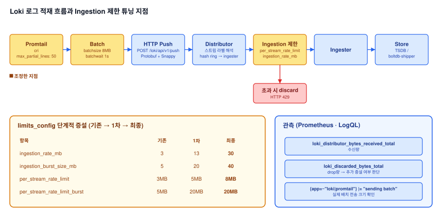

# Loki 로그 누락(Drop) 원인분석 및 Ingestion Rate Limit 튜닝

## 1. 배경

### 가. 증상

1) 복수 SaaS 서비스군에서 Loki 로그 누락 현상을 파악, 모니터링 체계 보완 필요
2) 개발자로부터 "특정 시간대 로그가 보이지 않는다"는 제보를 받아 처음 인지

## 2. 원인 좁혀가기

| 순서 | 가설 | 검증·조치 | 결과 |
|---|---|---|---|
| 1 | 볼륨 용량 부족으로 로그가 삭제됨 | retention 설정·PVC 사용률 확인 | 모두 정상 → 배제 |
| 2 | 수집·전송 단계에서 로그가 버려짐 | 누락 시간대의 Promtail·Loki 로그를 수신량·drop 메트릭(`loki_distributor_bytes_received_total`, `loki_discarded_bytes_total`)과 대조 | 특정 서비스 모듈의 멀티라인 대용량 로그가 ingestion rate limit을 초과해 drop → **확정** |
| 3 | 제한값을 얼마나 올려야 하는가 | 관측 최대 수신량 + 20% 버퍼로 1차 상향, drop 메트릭 재관찰 | 1차 후에도 drop이 남아 최종 증설(3 → 13 → 30MB), 전체 서비스군 반영 |

## 3. 기대효과

### 가. 정확한 근본 원인 특정

1) 단순 용량 부족이 아니라, 특정 서비스 모듈의 멀티라인 대용량 로그 유입이 Loki의 ingestion 제한을 초과시켜 drop이 발생하는 구조적 원인을 로그 적재 흐름 분석으로 규명

### 나. 안정적인 단계적 튜닝

1) 제한값을 한 번에 크게 올리지 않고, drop 카운트를 모니터링하며 2단계로 증설(3 → 13 → 30MB)해 과도한 리소스 할당 없이 안정적으로 문제 해소
2) 1차 값은 관측한 최대 수신량에 약 20% 버퍼를 더해 정하고, 1차 이후에도 남은 drop을 확인한 뒤 최종 값으로 추가 증설

### 다. AS-IS / TO-BE 비교

| 항목 | AS-IS | TO-BE |
|---|---|---|
| 로그 누락 원인 | 미파악 | 멀티라인 대용량 로그 유입 → ingestion 제한 초과로 특정 |
| Rate Limit | 낮은 기본값 (3MB) | drop 모니터링 기반 2단계 증설 (3 → 13 → 30MB) |
| 반영 범위 | - | 전체 SaaS 서비스군 반영 완료 |
| 관측 체계 | - | Prometheus 메트릭 + LogQL로 수신량·drop량 상시 추적 |

## 4. 구성도 (원인분석 및 조치 흐름)



```
STEP 1  복수 SaaS 서비스군에서 Loki 로그 누락 현상 파악
  │
  ▼
STEP 2  Promtail → Loki 로그 적재 흐름 단계별 점검
  │
  ▼
STEP 3  특정 서비스 모듈의 멀티라인 대용량 로그 유입 확인
  │
  ▼
STEP 4  Ingestion Rate Limit 초과로 인한 drop 발생 원인 규명
  │
  ▼
STEP 5  Rate Limit 단계적 증설 + drop 카운트 모니터링
  │
  ▼
STEP 6  전체 SaaS 서비스군에 설정 반영 완료
```

## 5. 성과

1) 로그 누락 현상의 근본 원인을 멀티라인 대용량 로그 유입 → ingestion 제한 초과로 정확히 특정
2) drop 카운트를 모니터링하며 단계적으로 제한값을 조정하는 방식으로, 과도한 일괄 증설 없이 안정적으로 튜닝
3) 전체 SaaS 서비스군에 설정을 반영해 로그 누락 문제를 해소

## 6. 회고

1) **"삭제"가 아니라 "미수신"을 의심** — 볼륨 용량 부족에 의한 삭제를 먼저 의심했으나 retention·PVC 사용률이 정상임을 확인하고, 누락 시간대의 Promtail·Loki 로그를 메트릭과 대조해 수신 단계에서 버려졌음을 규명
2) **근거 있는 단계적 튜닝** — 제한값을 감으로 크게 올리지 않고, 관측 최대 수신량에 20% 버퍼를 더해 2단계로 증설하며 매 단계 drop 메트릭으로 효과를 확인
3) **다시 진행한다면: drop 알림부터 설정** — 유실을 개발자 제보로 처음 인지한 탐지 공백이 있었으므로, `loki_discarded_bytes_total` 증가 시 알림이 발생하도록 설정해 사용자보다 먼저 유실을 감지하는 체계를 갖출 것 (향후 설정 예정)

---

## 상세 문서

Rate Limit 설정값, Promtail 배치 설정, 데이터 적재 흐름 상세 등을 포함한 상세 문서는 비공개 리포지토리에 별도 보관 중입니다. 필요 시 요청해주시면 공유드리겠습니다.
