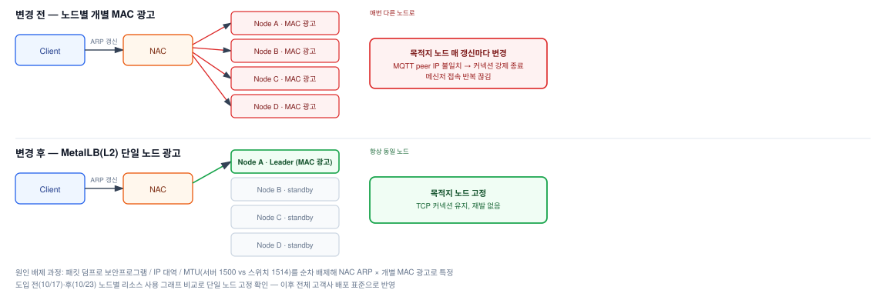

# 고객사 NAC 장비 ARP 갱신 × Ingress 개별 IP 광고 충돌로 인한 메신저 접속 장애

## 1. 배경

### 가. 증상

1) 특정 고객사(공공기관, 내부 NAC 네트워크 보안 장비 운영)에서 메신저 서비스 접속이 간헐적으로
   끊기고 재접속을 반복하는 장애 발생

### 나. 원인

1) 고객사 내부 NAC(네트워크 접근 제어 장비)가 주기적으로 서비스 IP에 대한 ARP(MAC 주소) 테이블을 갱신
2) 문제 발생 시점 기준, Ingress Controller(Traefik)의 External IP가 각 노드에서 개별적으로
   수동 설정(구축 당시 설정)되어 있어 여러 노드가 동일 서비스 IP에 대해 각자 MAC을 광고하는 상태였음
3) NAC가 주기적으로 ARP를 갱신할 때마다 서로 다른 노드의 MAC 주소로 전환되면서, 기존 TCP
   커넥션이 끊기고 재접속을 반복하게 됨
4) VIP의 MAC이 다른 노드로 전환되면 클라이언트의 TCP 연결이 실제로 다른 노드의 프로세스로
   넘어가는데, 이때 MQTT 브로커(서버) 프로세스가 인식하는 클라이언트 peer IP(연결 식별자)가
   달라지면서 기존 연결과 다른 연결로 처리되어 MQTT 클라이언트가 강제로 끊어짐

## 2. 원인 좁혀가기

| 순서 | 가설 | 검증·조치 | 결과 |
|---|---|---|---|
| 1 | 클라이언트 PC 보안프로그램 | 클라이언트 IP 대역 변경 시험 — 1차 서버와 같은 대역, 2차 사용자 PC 대역에서 재현 여부 확인 | 서버와 같은 대역에서도 동일 증상 → 사용자 PC 측 문제 아님 |
| 2 | 스위치 MTU 불일치 (서버 1500 vs 스위치 1514) | MTU 크기 확인 | 원인 아님, 배제 |
| 3 | 고객사 NAC 장비 | 고객사에 장비 확인 요청 | 고객사 회신 "장비 이상 없음" — 일단 후순위로 넘어감 |
| 4 | 연결 목적지 노드가 바뀌는 구조 | MQTT 브로커가 보는 클라이언트 peer IP(k8s 노드) 관찰 | peer IP가 주기적으로 바뀌는 패턴 발견 → 이를 근거로 NAC 재확인 요청 |
| 5 | NAC ARP 갱신 × 노드별 MAC 광고 충돌 | NAC 갱신 동작 확인, MetalLB로 단일 노드 광고 전환 | 전환 후 재발 없음 → **확정** |

## 3. 기대효과

### 가. 근본 원인 해소를 통한 서비스 연속성 확보

1) 서비스 IP의 MAC을 단일 노드에서만 광고하도록 구조를 바꿔, NAC의 ARP 갱신 여부와 무관하게
   접속 목적지가 유지되도록 개선

### 나. 표준화를 통한 재발 방지 확대

1) 이번 사례에서 발견한 구조적 리스크를 해당 고객사만이 아니라 전체 배포 표준에 반영

### 다. AS-IS / TO-BE 비교

| 항목 | AS-IS | TO-BE |
|---|---|---|
| 서비스 IP MAC 광고 | 모든 노드가 개별적으로 동일 서비스 IP의 MAC 광고 | MetalLB(L2 모드)로 단일 노드만 광고 |
| NAC ARP 갱신 영향 | 갱신마다 목적지 노드가 바뀌어 TCP 커넥션 단절 | 목적지 노드 고정, 갱신과 무관하게 커넥션 유지 |
| 원인 규명 방식 | 증상 재현 위주 | 패킷 덤프로 보안프로그램/IP 대역/MTU 등 후보를 순차 배제 |
| 메신저 헬스체크 | 조치 중 일시 제외 | Spring Boot Actuator로 재구성 |
| 적용 범위 | 해당 고객사 이슈 대응 | MetalLB를 전체 고객사 배포 표준으로 반영 |

## 4. 조치 흐름



```
STEP 1  고객사 메신저 접속 불안정(간헐적 끊김/재접속) 보고
  │
  ▼
STEP 2  패킷 덤프로 보안프로그램, IP 대역, MTU 등 후보를 순차 배제
  │
  ▼
STEP 3  NAC ARP 갱신 × 개별 노드 MAC 광고 충돌을 원인으로 특정
  │
  ▼
STEP 4  MetalLB 도입으로 단일 노드 MAC 광고 구조로 전환
  │
  ▼
STEP 5  변경 전/후 리소스 그래프로 서비스 연속성 확인 → 전체 배포 표준으로 반영
```

## 5. 성과

1) MetalLB 도입 이후 동일 문제 미재발 확인
2) 원인이 된 구조(개별 노드 IP 광고)를 근본적으로 해소한 MetalLB를 전체 고객사 배포 표준으로 반영
3) 패킷 덤프 기반으로 여러 후보를 하나씩 배제해가며 근본 원인을 특정한 체계적 RCA 사례

## 6. 회고

1) **근거로 외부 영역의 재확인을 이끌어냄** — 보안프로그램·IP 대역·MTU 등 클라이언트 측 후보를 차례로 배제한 뒤, 서버가 보는 MQTT peer IP(k8s 노드)가 주기적으로 바뀌는 패턴을 발견. 고객사는 초기 확인 요청에 NAC 장비 이상 없음으로 회신했지만, 이 패턴을 근거로 재확인을 요청해 원인을 특정
2) **구조로 해결하고 표준화** — 구축 당시 노드마다 수동 설정돼 있던 Ingress External IP(여러 노드가 같은 서비스 IP의 MAC을 광고)를 MetalLB L2 단일 노드 광고로 전환하고, 전체 고객사 배포 표준으로 반영(완료)
3) **다시 진행한다면: 연결 단위 점검을 초기 진단 순서에** — 간헐적 접속 끊김은 클라이언트 측 가설보다 서버 측 연결 정보(peer IP 분포, 노드별 `ip neigh`, 클라이언트 `arp -a`의 MAC 변화)를 먼저 수집하도록 진단 런북을 구성해, "목적지가 바뀌는 구조"를 더 이른 단계에서 포착

---

## 상세 문서

패킷 덤프 분석 상세, 리소스 증설 수치, 헬스체크 재구성 방법 등 세부 내용을 포함한 상세 문서는
비공개 리포지토리에 별도 보관 중입니다. 필요 시 요청해주시면 공유드리겠습니다.
